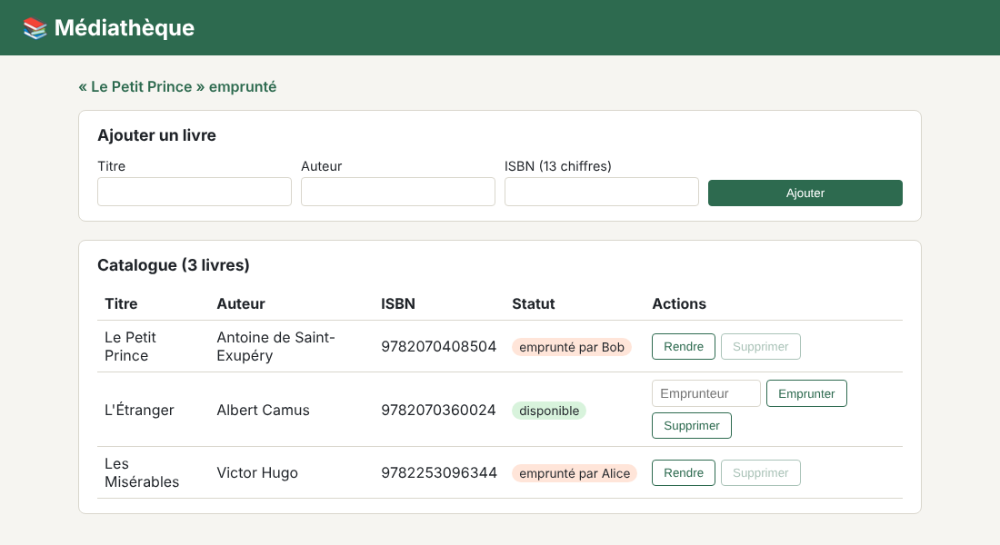
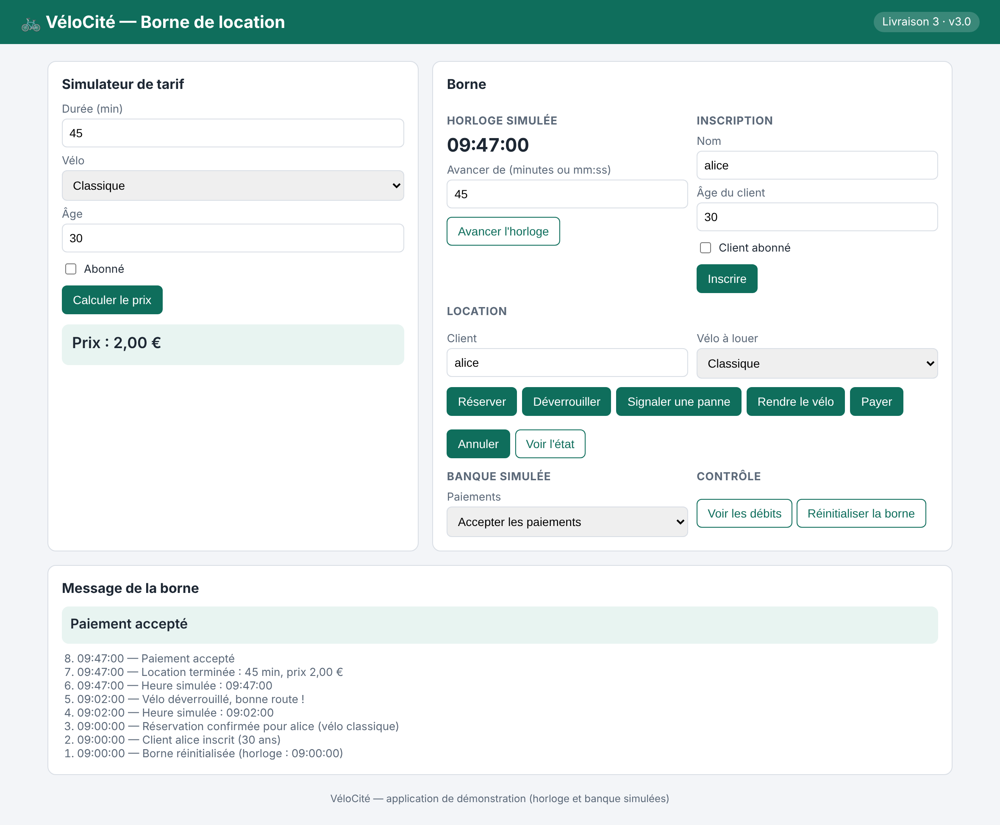

# 🖥️ Automatisation des tests d'interface web

> Projet réalisé dans le cadre de ma **formation de testeuse logicielle (ENI)**. J'y ai automatisé les tests d'interface de trois applications web, en passant de **Selenium IDE** (enregistrement) à **Robot Framework** avec deux bibliothèques : **SeleniumLibrary** (WebDriver) et **Browser** (basée sur Playwright).


---

## 🎯 Ce que montre ce projet

| Application | Outil | Ce qui est automatisé | Tests |
|---|---|---|:---:|
| 🔐 **Générateur de mot de passe** (page web statique) | Selenium IDE, puis Robot + **SeleniumLibrary** | Plan de test corrigé (US 1 à 3), y compris la lecture des couleurs d'un `<canvas>` | 26 |
| 📚 **Médiathèque** (Flask + interface web) | Robot + **Browser** (Playwright) | Parcours utilisateur : consulter, ajouter, emprunter, rendre, supprimer | 9 |
| 🚲 **VéloCité** (borne de location de vélos) | Robot + **Browser** (Playwright) | Campagne de **régression** issue du cahier de tests manuel | 15 |
| 🎬 Guru99 · 🧠 Memory | **Selenium IDE** | Revue des scripts proposés en formation et version corrigée | 2 TP |

```
Tests                                                       | PASS |
50 tests, 43 passed, 0 failed, 7 skipped
```

Les **7 tests « skipped »** ne sont pas des erreurs de script : ce sont les **anomalies connues** du générateur (voir plus bas). Ils échouent sur leur vérification, et passeront au vert dès que l'anomalie sera corrigée.

---

## 🗂️ Organisation

```
automatisation-interface-web/
├── applications/                 ← les 3 applications testées (copies locales)
│   ├── generateur/               ← page HTML / JavaScript
│   ├── mediatheque/              ← API Flask + base SQL + interface web
│   └── velocite/                 ← 5 livraisons (paquets .whl)
├── selenium-ide/                 ← TP Selenium IDE : scripts .side + revues
│   ├── 01-guru99/
│   ├── 02-memory/
│   └── 03-generateur/            ← revue du plan et du script proposés
├── tests/
│   ├── resources/                ← « Page Objects » : un fichier par écran
│   │   ├── commun.resource           démarrage / arrêt des applications
│   │   ├── navigateur.resource       ouverture du navigateur Playwright
│   │   ├── generateur.resource       SeleniumLibrary
│   │   ├── mediatheque.resource      Browser
│   │   └── borne_velocite.resource   Browser
│   ├── selenium/generateur.robot
│   └── playwright/
│       ├── mediatheque_ui.robot
│       └── velocite_regression.robot
├── docs/plan-de-test-generateur.md
└── .github/workflows/            ← campagne lancée à chaque push
```

---

## 1️⃣ De Selenium IDE à Robot Framework

J'ai commencé par **Selenium IDE** (enregistrer, rejouer, ajouter des vérifications). En relisant les scripts proposés en formation, j'ai trouvé des défauts importants, par exemple :

- des commandes **`storeText`** (mémoriser) à la place de **`assertText`** (vérifier) : 3 tests sur 10 étaient verts **sans rien vérifier** ;
- un test « caractères spéciaux » qui cochait les chiffres ;
- un `assertText` sur un champ de saisie, alors que le texte saisi se lit avec **`assertValue`**.

📄 Détails : [Guru99](selenium-ide/01-guru99/README.md) · [Memory](selenium-ide/02-memory/README.md) · [Générateur](selenium-ide/03-generateur/README.md)

Selenium IDE atteint vite ses limites (pas de lecture de `<canvas>`, pas de boucle propre, scripts difficiles à maintenir). J'ai donc réécrit les tests dans **Robot Framework**.

## 2️⃣ Générateur de mot de passe : SeleniumLibrary

📄 Plan de test corrigé : [`docs/plan-de-test-generateur.md`](docs/plan-de-test-generateur.md) · Tests : [`generateur.robot`](tests/selenium/generateur.robot)

- **Valeurs limites** : longueurs 1, 50 et 51, puis 0, -1 et vide.
- **Résultat aléatoire** : on ne peut pas prévoir le mot de passe, alors je vérifie des **propriétés** (longueur, caractères autorisés par expression régulière, 5 clics = 5 mots de passe différents).
- **Indicateur dessiné dans un `<canvas>`** : il n'y a pas de texte à lire. Le mot-clé `Couleurs de l'indicateur` lit la couleur d'un pixel de chaque zone (`Execute Javascript`) et la traduit en « rouge », « orange »…

```robotframework
CT-25 La diversité des caractères augmente le niveau
    Générer un mot de passe    6    minuscules
    Seul le niveau est allumé    Moyen    orange
    Cocher exactement    @{TOUS}
    Générer
    Seul le niveau est allumé    Correct    jaune
```

### 🐞 Anomalies trouvées

| Anomalie | Tests | Constat |
|---|---|---|
| Longueur invalide acceptée | CT-11, 12, 13 | -1, 0 ou vide : mot de passe **vide**, aucun message |
| Limite de 50 non contrôlée | CT-14 | 51 caractères générés |
| Types non garantis | CT-15 | ex. `%/+x` avec les 4 types cochés : pas de majuscule |
| Longueur < nombre de critères | CT-16 | 3 caractères pour 4 critères, aucun message |
| Indicateur non réinitialisé | CT-26 | Après « aucun critère », l'ancien niveau reste affiché |

Ces tests portent le tag **`bug-connu`** et la campagne est lancée avec `--skiponfailure bug-connu` : l'anomalie reste visible dans le rapport sans bloquer la campagne.

## 3️⃣ Médiathèque : Browser (Playwright)

📄 Tests : [`mediatheque_ui.robot`](tests/playwright/mediatheque_ui.robot)



- Sélecteurs **`data-testid`** : ils ne cassent pas si le design ou les textes changent.
- Chaque test repart d'un **catalogue de référence** remis par l'API (`/api/test/reset`) : les tests sont indépendants.
- **UI-08, test multicouche** : le livre est ajouté par l'API (rapide), seul l'affichage est vérifié dans l'interface.

```robotframework
UI-04 Emprunter puis rendre un livre
    Emprunter le livre    ${ISBN_PETIT_PRINCE}    Bob
    Vérifier le message    « Le Petit Prince » emprunté
    Vérifier le statut du livre    ${ISBN_PETIT_PRINCE}    emprunté par Bob
    Rendre le livre    ${ISBN_PETIT_PRINCE}
    Vérifier le statut du livre    ${ISBN_PETIT_PRINCE}    disponible
```

> Les tests de l'**API** et de la **base de données** de la Médiathèque sont dans mon projet [mediatheque-tests-api](https://github.com/ania-sekhi/mediatheque-tests-api).

## 4️⃣ VéloCité : campagne de régression

📄 Tests : [`velocite_regression.robot`](tests/playwright/velocite_regression.robot)



VéloCité est l'application de mon projet [velocite-campagne-de-test](https://github.com/ania-sekhi/velocite-campagne-de-test) (plan de test, cahier de tests, 5 livraisons). Une fois les cas **manuels** stabilisés, j'ai automatisé ceux qu'on rejoue à chaque livraison :

| Cas | Technique | Ce qui est vérifié |
|---|---|---|
| CT-25 (×6) | Table de décision | Prix selon durée, âge, abonnement, type de vélo |
| CT-14, CT-10 | Valeurs limites | Pénalité à 1 440 / 1 441 min, plafond électrique à 270 / 300 / 301 min |
| CT-19 | Transitions d'état | Réservation valable à 15:00, expirée à 15:01 |
| CT-22, CT-23 | Non-régression | Paiement refusé, double paiement (anomalie DEF-11) |

- **Page Object** : tous les sélecteurs de la borne sont dans [`borne_velocite.resource`](tests/resources/borne_velocite.resource). Quand la livraison 4 a renommé le bouton « Payer » en « Régler », une seule ligne a changé (`${BOUTON_PAYER}`).
- **Test Template** : les 6 exemples de la table de décision utilisent le même mot-clé, une ligne de données par test.

## SeleniumLibrary ou Browser ?

| | SeleniumLibrary (WebDriver) | Browser (Playwright) |
|---|---|---|
| Attente des éléments | À prévoir (`Wait Until…`) | Automatique avant chaque action |
| Sélecteurs | id, css, xpath | css, texte, rôle ARIA (`role=button[name="Régler"]`), chaînage `>>` |
| Installation | Navigateur + driver de la même version | `rfbrowser init` installe tout |
| Quand je l'utilise | Applications déjà testées avec Selenium, ou besoin de WebDriver | Nouveaux tests, interfaces dynamiques |

---

## ▶️ Lancer les tests

```bash
pip install -r requirements.txt
pip install applications/velocite/velocite-5.0-py3-none-any.whl   # livraison testée
rfbrowser init chromium                                            # navigateur de la bibliothèque Browser

robot --outputdir results --skiponfailure bug-connu tests          # toute la campagne
robot --outputdir results -i mediatheque tests                     # une seule application
robot --outputdir results -v HEADLESS:False tests/playwright       # voir le navigateur
```

Chaque suite démarre elle-même l'application qu'elle teste. Le rapport s'ouvre dans `results/report.html`.

La campagne tourne aussi dans **GitHub Actions** à chaque `push` ([workflow](.github/workflows/tests-interface.yml)) ; le rapport est téléchargeable dans l'onglet *Actions*.

## ✅ Compétences

Selenium IDE (revue de scripts) · Robot Framework · SeleniumLibrary · Browser / Playwright · Page Object · sélecteurs robustes (`data-testid`, rôles ARIA) · valeurs limites · tables de décision · transitions d'état · tests de propriétés sur un résultat aléatoire · tests de régression · intégration continue (GitHub Actions)
