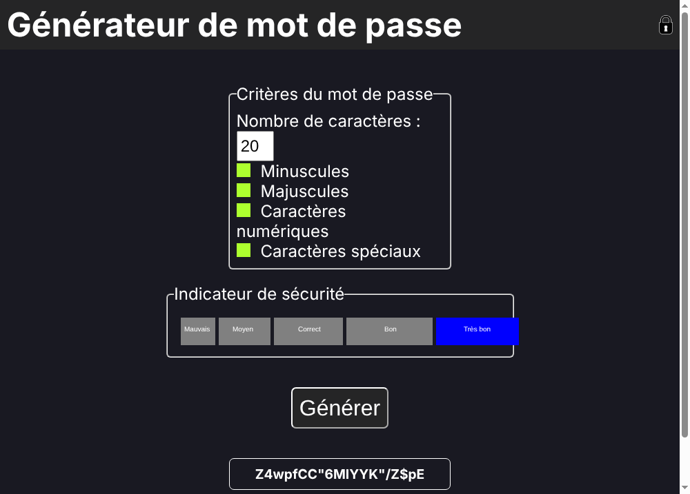

# Plan de test corrigé : générateur de mot de passe

[← Retour au projet](../README.md)

## User stories

| US | En tant qu'utilisateur, je veux… | Critères d'acceptation |
|---|---|---|
| **US 1** | choisir le nombre et les types de caractères | Longueur de 1 à 50 ; minuscules, majuscules, chiffres et/ou caractères spéciaux parmi ``! " # $ % & ' ( ) * + , - . /`` |
| **US 2** | cliquer sur « Générer » et voir le mot de passe | Le mot de passe respecte les choix et s'affiche immédiatement |
| **US 3** | obtenir un indicateur de sécurité | Affiché après la génération, il dépend de la longueur et de la diversité des caractères |
| ~~US 4~~ | copier le mot de passe | *Hors périmètre du TP* |

## Cas de test

Techniques utilisées : **valeurs limites** (1, 50, 51, 0, -1), **partitions d'équivalence** (un type par test, tous les types, aucun), **tests de propriétés** sur un résultat aléatoire.

| ID | US | Cas | Données | Résultat attendu |
|---|:---:|---|---|---|
| CT-01 à 03 | 1 | Longueur respectée | 1 / 12 / 50, minuscules | 1 / 12 / 50 caractères |
| CT-04 à 07 | 1 | Un seul type coché | 30, minuscules / majuscules / chiffres / spéciaux | Uniquement des caractères de ce type |
| CT-08 | 1 | Tous les types | 30, les 4 cochés | Uniquement des caractères autorisés |
| CT-09 | 1 | Aucun critère | 12, rien coché | « Impossible de générer le mot de passe sans critères » |
| CT-10 | 1 | Lettres dans la longueur | « un_Mot » | Le champ reste vide |
| CT-11 à 13 | 1 | Longueur invalide | -1 / 0 / vide | Message d'erreur |
| CT-14 | 1 | Longueur hors limite | 51 | Refusé (≤ 50) |
| CT-15 | 1 | Chaque type coché est présent | 4, les 4 cochés, 20 générations | Au moins 1 caractère de chaque type |
| CT-16 | 1 | Moins de caractères que de critères | 3, les 4 cochés | Message d'erreur |
| CT-17 | 2 | Affichage après le clic | 12 | Le texte d'attente est remplacé par 12 caractères |
| CT-18 | 2 | Nouveau mot de passe à chaque clic | 20, 5 clics | 5 mots de passe différents |
| CT-19 | 3 | Indicateur avant génération | | Les 5 zones sont grises |
| CT-20 à 24 | 3 | Niveau selon la longueur | 1 / 5 / 8 / 12 / 20, minuscules | Mauvais rouge / Moyen orange / Correct jaune / Bon vert / Très bon bleu, les autres zones grises |
| CT-25 | 3 | La diversité augmente le niveau | 6 : minuscules puis les 4 | Moyen → Correct |
| CT-26 | 3 | Génération impossible après une génération | 20 puis aucun critère | L'indicateur revient à l'état initial |

## 🐞 Anomalies constatées

| Anomalie | Tests | Constat |
|---|---|---|
| Longueur invalide acceptée | CT-11, 12, 13 | -1, 0 ou vide : mot de passe **vide**, aucun message |
| Limite de 50 non contrôlée | CT-14 | 51 caractères générés (`max="50"` ne bloque pas la saisie clavier) |
| Types non garantis | CT-15 | La plupart des mots de passe de 4 caractères sont incomplets (ex. `%/+x` : pas de majuscule) |
| Longueur < nombre de critères | CT-16 | 3 caractères avec 4 critères : aucun message (ex. `R0.`) |
| Indicateur non réinitialisé | CT-26 | Après « aucun critère », l'indicateur affiche toujours le niveau précédent |

Ces 7 tests sont tagués `bug-connu` dans Robot Framework : ils restent dans la campagne et passeront au vert dès que l'anomalie sera corrigée.
